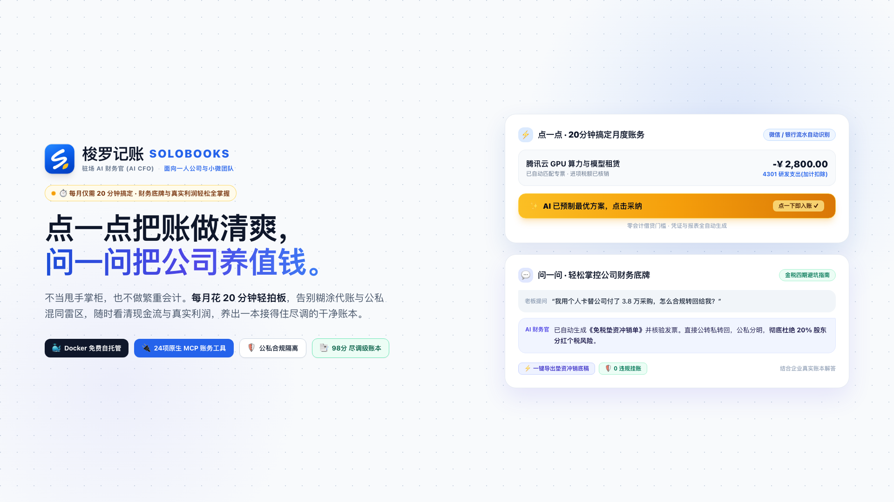

# 梭罗记账 SoloBooks · 小微企业的驻场 AI 财务官

<p align="center">
  
</p>

<p align="center">
  <a href="https://solobooks.cn/login"></a>
  <a href="#自托管快速开始"></a>
</p>

<p align="center">
  <a href="LICENSE"></a>
  <a href="#技术栈"></a>
  <a href="#技术栈"></a>
  <a href="docs/mcp-integration.md"></a>
</p>

**梭罗记账**是一套面向**一人公司（OPC）与小微企业**的 AI 智能记账与自助报税系统：微信/银行流水与全电发票自动识别，AI 预制入账方案，老板点一点确认即可入账；财税疑难随时大白话提问；月末自动结账检查，一键生成电子税务局申报底稿。「老板白话视图 + 会计标准账表」同源映射，养出一本**票流一致、公私分明、随时经得起审计与投资人尽调**的干净账。

> 梭罗一个人在瓦尔登湖畔独立生活、劳作与记录——一个人的公司，更值得一套清晰透明、自主可控的账税体系。

---

## 你的账，是不是也这样？

小微企业管账只有三条老路，每条都坑：

| 老路 | 现实 |
|---|---|
| 🧾 **找代账** | ¥200/月只管抄发票填表：银行流水不对、公私往来全塞「其他应收款」；1 个人管 200 家，问句半天回 |
| 📊 **自己记** | 满屏会计术语和复杂大表格，借贷分不清，坚持不过三天 |
| 👔 **招会计** | 一年 8~15 万刚性成本，一人公司根本养不起 |

更危险的是后果——**金税四期「以数治税、穿透式监管」**之下，廉价代账留下的公私不分与糊涂烂账是随时会爆的雷；等要申请银行授信、申报补贴、面对股权融资尽调（DD）时，才发现这本账必须推倒重做。

**老板要的从来不是一张张凭证，而是一本随时看得懂、经得起查的干净账。**

## 梭罗记账怎么解

- **点一点，20 分钟搞定月度账务**：微信/银行流水自动识别，AI 已预制最优入账方案，点一下「采纳」即入账，零会计门槛
- **问一问，7×24 财税顾问在线**：「用个人卡替公司付了 3.8 万采购，怎么合规转回？」这类疑难，大白话直接问，回答附政策依据
- **公私分明，隔离个税雷区**：垫资自动生成冲销单并核验发票，公私转化全程留痕，规避 20% 股东分红个税风险
- **小企业会计准则 · 尽调级账本**：严格借贷平衡，凭证与三表同源，从第一天起按投资人期许的样子管账

| | 专职会计 | 传统代账 | 梭罗 AI 财务官 |
|---|---|---|---|
| 成本 | 年薪 8~15 万 | ¥200~500/月 | **云端免费版 0 元** |
| 账本质量 | 好，但贵 | 科目混乱乱挂往来，报表失真 | 严格遵循《小企业会计准则》 |
| 财税答疑 | 下班就找不到 | 只管抄税，回复迟缓 | 7×24 随时问 |
| 经营掌控 | 看人 | 账本是黑盒，真实赚多少看不懂 | 老板白话视图 + 会计标准账表 |
| 数据归属 | 在公司 | 常被中介扣留，换代账扯皮 | **100% 归企业，云端/本地你选** |

## 两种免费用法

### ☁️ 云端免费版 —— 推荐大多数老板

**[solobooks.cn](https://solobooks.cn) 注册即用，0 元**：

- **全功能无阉割**，与付费版功能一致，最多 3 个账套
- 每月赠 **10 万 AI Token**（含票据识别与财税问答）
- 免买免运维服务器，Web 与移动端实时云同步
- 注册即自动生成一本带样本数据的演示账套，30 秒上手

👉 **[立即免费注册 →](https://solobooks.cn/login)**

> 需要更多？标准版（¥598/年）含 1对1 历史旧账导入与专属服务群，人机双签版含注册会计师季度审账——详见 [solobooks.cn/free](https://solobooks.cn/free)。

### 🐳 开源自托管 —— 推荐技术用户与数据敏感企业

- [SoloBooks License v2.0](LICENSE)：个人、个体工商户、一人公司与小微企业可**永久免费自托管**，用于本企业内部记账与报税（含产生经营收入的真实记账）
- 数据 100% 留在自己的服务器；AI 能力接你自选的大模型 API Key
- 全功能开源无阉割，与云端版同一套代码底座

👉 上手见下方 **[自托管快速开始](#自托管快速开始)**。

## 功能特性

- **智能记账**：AI 识别文字/语音/单据 → 自动判断收支方向、金额与费用分类，生成凭证草稿；**AI 只起草，入账必须人工确认**
- **微信/银行流水智能认领**：账单导入后以流水为客观事实认领到发票或凭证；微信支付账单支持逐笔导入或按月汇总生成 1 张综合凭证
- **越用越准的专属记忆规则**：确认过的流水记住「对手方 + 用途 + 金额区间」，同类流水下次自动优先命中；命中与纠正全程留痕，规则可查、可改、可停用
- **自助报税与申报小抄**：增值税、企业所得税预缴/汇算、经营所得个税（A 表预缴 / B 表汇算 / C 表提示，查账征收）测算；一键生成电子税务局申报数据包，自主申报不求人
- **发票全流程**：全电发票 Excel 导入（标准列名自动映射）、AI 智能分类、发票台账、明细查验与进销项核对
- **月度结账向导**：五步向导 + 五项结账检查 + 跨期补记/暂估闭环，未配平不允许关账
- **标准财税报表**：资产负债表、利润表、现金流量表、所有者权益变动表、试算平衡、科目余额表、总账/明细账/序时账/多栏账、往来账龄与税务申报底稿导出
- **老板 / 会计双视图**：一键切换经营视角与专业视角，同一套账、同一个 URL；只改导航与信息密度，不改权限
- **固定资产 / 无形资产**：卡片、自动折旧/摊销、处置与总账核对
- **薪酬管理**：工资表导入、社保公积金计提、工资四凭证、研发工时分配
- **数量金额式核算**：科目级开关、凭证数量录入、余额表数量结存
- **通用归集与分摊**：辅助核算维度、归集规则、待归集清单、报表口径对比
- **老板私账**：个人收支记录（收入/支出/垫付）与公司账目联动
- **账套迁移与归档**：旧账导入、期初建账、电子账簿打印、数据备份归档
- **多账本 / 多主体**：多公司账本切换，owner / accountant / preparer / viewer 角色权限

## AI 连接（MCP）

梭罗记账内置 **27 个原生 MCP 工具**（20 只读 + 7 草稿写入）：Claude Desktop、Cursor 等任何支持 MCP 的外部 AI 都能安全接入你的账本。安全红线是**人机双签**——AI 只产生待确认草稿、绝不直接入账，不碰密码与提交按钮。

- 接入指南：[docs/mcp-integration.md](docs/mcp-integration.md)
- 图文版 AI 连接中心：[solobooks.cn/ai-connect](https://solobooks.cn/ai-connect)

## 自托管快速开始

> 依赖：Python 3.13+、Node.js、Docker（本地 PostgreSQL）。完整流程（热更新、数据库变更、生产部署细节）见 [docs/development-workflow.md](docs/development-workflow.md)。

**生产部署（Docker Compose 一键拉起 PostgreSQL + 后端 + 前端）：**

```bash
cd deploy
cp .env.staging.example .env.staging.local   # 填入真实密钥
docker compose up -d
```

**本地开发（后端 8001 / 前端 5173）：**

```bash
# 1. 起本地 PostgreSQL
docker run -d --name solobooks-pg -e POSTGRES_USER=postgres -e POSTGRES_PASSWORD=postgres \
  -e POSTGRES_DB=solobooks -p 5432:5432 postgres:16-alpine

# 2. 后端（配好 backend/.env 后迁移建表并启动）
cp backend/.env.example backend/.env    # 至少填 DASHSCOPE_API_KEY 与 DATABASE_URL
cd backend && python -m alembic upgrade head && python -m uvicorn main:app --port 8001 --reload

# 3. 前端
cd web && npm install && npm run dev
```

浏览器打开 `http://localhost:5173`，注册后自动生成一本演示账套。

## 运行测试

```bash
cd backend && pytest      # 后端
cd web && npm run test    # 前端
```

## 技术栈

| 层 | 技术 |
|---|---|
| 后端 | Python 3.13 · FastAPI · SQLAlchemy(async) · Alembic |
| 数据库 | PostgreSQL 16 |
| 前端 Web | Vue 3 · TypeScript · Vite · Naive UI · Pinia · Tailwind |
| 移动端 | uni-app Vue 3 + TypeScript（`mobile/`，微信小程序为主渠道；仅私有仓库维护） |
| 部署 | Docker Compose · Nginx |

## 目录结构

```
.
├── backend/            # FastAPI 后端
│   ├── routers/        # API 路由（记账/账簿/报表/发票/银行/资产/税务/MCP…）
│   ├── services/       # 业务服务（记账/分类/对账/折旧/税表/归集…）
│   ├── alembic/        # 数据库迁移
│   └── tests/          # 后端测试
├── web/                # Vue 前端
│   ├── src/pages/      # 页面（工作台/AI CFO/账本/报表/结账/归集…）
│   └── docs/           # 前端设计规范与页面交互文档
├── mobile/             # 移动端工程（仅私有仓库维护）
├── deploy/             # Docker/生产部署配置
├── brand/              # 品牌素材（logo、封面、favicon）
└── docs/               # 开发与运维文档
```

## 文档索引

| 文档 | 说明 |
|---|---|
| [web/docs/pages-and-interactions.md](web/docs/pages-and-interactions.md) | 前端页面、路由与交互逻辑总览 |
| [docs/development-workflow.md](docs/development-workflow.md) | 本地热更新、Docker 构建与数据库变更流程 |
| [docs/finance-core-runbook.md](docs/finance-core-runbook.md) | 财务核心运维与排障手册 |
| [docs/mcp-integration.md](docs/mcp-integration.md) | 外部 AI 接入设计与使用说明；在线图文版见 [AI 连接中心](https://solobooks.cn/ai-connect) |

## 贡献

欢迎通过 Issue 报告问题、提出建议或提交 PR。请阅读 [CONTRIBUTING.md](CONTRIBUTING.md) 了解贡献规范。

## 许可证与商业授权

本项目采用 [SoloBooks 源码可用许可 v2.0](LICENSE)：

- **个人与企业自用**：个人、个体工商户、一人公司与小微企业可**永久免费自托管**用于本企业内部记账（包括产生经营收入的真实记账场景），享有阅读源码、自用修改与部署运行的完整自由。
- **商业使用限制**：未经芥子星辰（杭州）智能科技有限公司书面授权，**禁止**将本软件用于对外 SaaS 托管经营、按用户/多租户收费、或持牌代账机构向客户提供商业记账/报税服务。
- **商业授权（Partner License）**：如需多租户云端连接器、代账批量管户平台或商业联合运营授权，请联系：**founder@jiezixingchen.com**。

## 免责声明

本项目不构成任何税务、法律或财务建议。涉及税务申报等专业事项，请咨询持牌专业人士。
